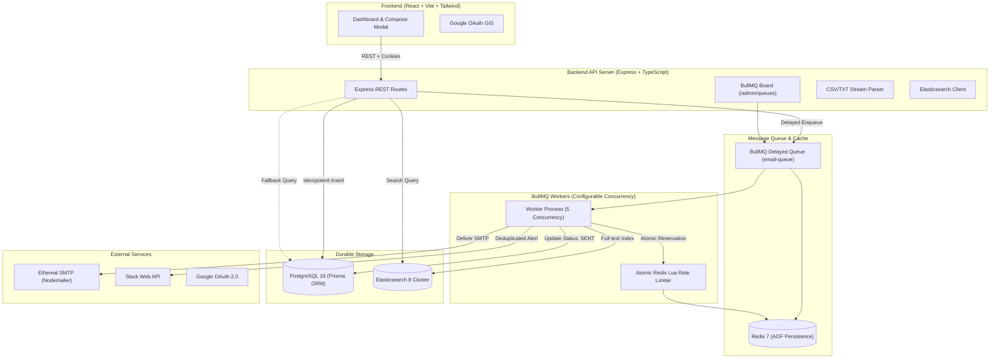

# ReachInbox Full-Stack Email Scheduler

A production-grade, distributed email scheduling service built with **Node.js, Express, TypeScript, BullMQ, Redis, PostgreSQL (Prisma), Elasticsearch, Nodemailer (Ethereal SMTP), and React (Vite & Tailwind CSS)**.

Designed strictly around **BullMQ delayed jobs** (no cron jobs, no periodic database polling), with multi-worker concurrency, atomic Redis Lua rate-limiting, crash-safe restart recovery, deduplicated Slack alerts, and full-text email search.

---

## 🏗️ Architecture Overview



---

## ⚡ Key Technical Innovations & Safety Guarantees

### 1. BullMQ Delayed Jobs — Zero Cron Primary Schedulers
Emails are enqueued directly into BullMQ delayed jobs using millisecond timestamps:
$$\text{delay} = \max(0, \text{scheduledAt} - \text{now}) + \text{index} \times \text{minDelayMs}$$
There are no `cron`, `node-cron`, `Agenda`, or periodic database polling loops as primary dispatchers.

### 2. Atomic Redis-Backed Sliding-Window Rate Limiting (Lua)
Per-sender hourly rate limits are enforced across arbitrary concurrent workers via an atomic Redis Lua script:
- Employs a sliding-window sorted set (`ZSET`) keyed by `ratelimit:sender:{senderId}:zset`.
- Cleans entries older than 3600 seconds.
- Atomically checks quota against `hourlyLimit` (capped by a global safety limit of 10,000/hr).
- Enforces `minDelayMs` (spacing between sends) via `ratelimit:sender:{senderId}:last_sent`.
- If limit is reached:
  1. The job is **not dropped or failed**.
  2. The next available slot is calculated: `oldest_timestamp + 3600s - now`.
  3. The job is rescheduled into BullMQ delayed queue.
  4. A `RateLimitEvent` is recorded in PostgreSQL.
  5. A deduplicated notification is dispatched to Slack.
- If delivery fails before SMTP acceptance, reservations are rolled back (`ZREM`) so legitimate quota is not consumed.

### 3. Persistent Restart & Crash Recovery
If workers or API instances restart:
- BullMQ states persist in Redis AOF.
- On startup, `SchedulerService.recoverUnscheduledJobs()` queries PostgreSQL for any orphaned records with status `SCHEDULED`, `RESCHEDULED`, or interrupted `PROCESSING`, verifies them against BullMQ, and re-enqueues missing jobs with correct future delay.

### 4. Elasticsearch Indexing with PostgreSQL Source of Truth
- Delivered and scheduled emails are indexed into Elasticsearch (`emails` index) with full-text search across recipients, subjects, bodies, and senders.
- PostgreSQL remains the primary system of record. If Elasticsearch is unreachable, queries seamlessly fall back to PostgreSQL `ILIKE`/insensitive queries.
- `ElasticsearchService.bulkSyncFromDatabase()` provides one-command recovery to re-index all historical records.

### 5. Deduplicated Slack Rate-Limit Notifications
When a sender reaches its hourly limit, Slack notifications are deduplicated per sender per hour using Redis keys (`slack:dedup:{senderId}:{hourKey}`). Repeated job retries within the same hour will never spam Slack channels.

---

## 🚀 Quickstart & Setup Guide

### 1. Prerequisites
- **Node.js**: v20.x or higher
- **npm**: v10.x or higher
- **Docker & Docker Compose**

### 2. Start Infrastructure Containers
Start PostgreSQL, Redis, and Elasticsearch:
```bash
docker compose up -d
```
Verify running health:
```bash
docker compose ps
# reachinbox_postgres (Port 5432) -> Healthy
# reachinbox_redis (Port 6379)    -> Healthy
# reachinbox_elasticsearch (9200) -> Healthy
```

### 3. Setup Backend & Database
```bash
# Push Prisma schema to PostgreSQL
npm run --workspace=backend prisma:db-push
# or
npx --prefix backend prisma db push

# Generate Prisma Client
npm run --workspace=backend prisma:generate

# Generate default Ethereal SMTP test account
npm run ethereal:setup
```

### 4. Run the Full Stack
To run the API, BullMQ Worker, and React Frontend concurrently:
```bash
npm run dev
```

Or start components individually in separate terminals:
```bash
# Terminal 1: Backend Express API
npm run dev:api

# Terminal 2: BullMQ Queue Worker
npm run dev:worker

# Terminal 3: React Vite Dashboard
npm run dev:frontend
```

---

## 🌐 Application Endpoints & Dashboards

| Service | URL | Description |
| :--- | :--- | :--- |
| **Frontend Dashboard** | `http://localhost:5173` | React UI matching Figma design |
| **Backend REST API** | `http://localhost:5000` | Express API & health endpoints |
| **BullMQ Board** | `http://localhost:5000/admin/queues` | Interactive queue & job monitor |
| **Elasticsearch** | `http://localhost:9200` | Cluster & search index |

---

## 🧪 Testing & Verification

Run the comprehensive test suite (including E2E flow, Redis Lua rate-limiter, CSV parser, and API integration tests):

```bash
npm test
```

### Test Coverage Highlights:
- `tests/e2e.test.ts`: End-to-end campaign scheduling, BullMQ delayed job verification, real Ethereal SMTP delivery, and Elasticsearch search.
- `tests/rateLimiter.test.ts`: Atomic Redis Lua sliding window enforcement, quota blocking, and usage calculation.
- `tests/scheduler.test.ts`: Recipient parsing, whitespace trimming, email deduplication, and invalid format filtering.
- `tests/api.test.ts`: Supertest API verification of `/health`, `/api/senders`, `/api/emails/parse`, `/api/dashboard/stats`, and `/admin/queues`.

---

## 📹 5-Minute Video Demo Checklist

Use this script and checklist when recording your five-minute demonstration:

1. **System Startup (0:00 - 0:45)**
   - Show `docker compose ps` displaying PostgreSQL, Redis, and Elasticsearch healthy.
   - Run `npm test` showing 12 passing tests across all 4 suites.
   - Start the stack with `npm run dev`.

2. **Dashboard & Multi-Sender Setup (0:45 - 1:30)**
   - Open `http://localhost:5173`.
   - Point out User profile (Alex Demo / Google auth) and Metric Cards.
   - Navigate to **Senders & SMTP** tab; click **"+ Create Ethereal Test Sender"** to auto-generate a fresh test account and verify SMTP connection.

3. **CSV Parsing & Scheduling (1:30 - 2:45)**
   - Click **"Compose Email"**.
   - Paste or upload a CSV with recipient emails (include a duplicate to demonstrate automatic deduplication badge).
   - Set a future start time (e.g., 1-2 minutes ahead) or immediate schedule with a 2-second delay.
   - Click **"Schedule Email"**.
   - Show the newly scheduled emails appear in the **Scheduled Emails** table with `SCHEDULED` status badges.

4. **BullMQ Board & Delivery Execution (2:45 - 3:45)**
   - Open `http://localhost:5000/admin/queues` in a new tab.
   - Show the delayed jobs waiting in the BullMQ queue.
   - Allow the scheduled time to arrive; watch the BullMQ worker pick up and process the jobs.
   - Switch back to the dashboard; show the jobs automatically transition to the **Sent Emails** table.
   - Click **"View in Ethereal"** to open the real message preview on `ethereal.email`.

5. **Rate Limiting, Slack Alerts & Elasticsearch Search (3:45 - 5:00)**
   - Open the **Slack** modal; show connection status and demonstrate the test rate-limit alert trigger.
   - Demonstrate Elasticsearch search bar by searching for keywords in recipient or subject, observing instantaneous results.
   - Demonstrate crash recovery by restarting the worker process.

---

## 📋 Requirement Acceptance Matrix

| Requirement | Implemented | Tested | Evidence / Test Command | Remaining Work |
| :--- | :---: | :---: | :--- | :--- |
| **BullMQ Delayed Scheduling** | ✅ | ✅ | `tests/e2e.test.ts`, `tests/scheduler.test.ts` | Complete |
| **PostgreSQL Persistence (Prisma)** | ✅ | ✅ | `npx prisma db push`, `tests/api.test.ts` | Complete |
| **Ethereal SMTP (Nodemailer)** | ✅ | ✅ | `tests/e2e.test.ts`, `npm run ethereal:setup` | Complete |
| **Atomic Redis Lua Rate Limiter** | ✅ | ✅ | `tests/rateLimiter.test.ts` | Complete |
| **Delayed Rescheduling on Limit** | ✅ | ✅ | `src/worker.ts`, `src/services/rateLimiter.ts` | Complete |
| **Minimum Send Delay Spacing** | ✅ | ✅ | Lua script check (`ratelimit:sender:{id}:last_sent`) | Complete |
| **Persistent Restart Recovery** | ✅ | ✅ | `SchedulerService.recoverUnscheduledJobs()` | Complete |
| **Idempotency Safeguards** | ✅ | ✅ | SHA-256 idempotencyKey + status checks | Complete |
| **Elasticsearch Search + Fallback** | ✅ | ✅ | `tests/e2e.test.ts`, `http://localhost:9200` | Complete |
| **Slack Integration & Deduplication**| ✅ | ✅ | `SlackService.notifyRateLimitReached()`, Redis dedup | External OAuth app credentials for production |
| **Google OAuth Integration** | ✅ | ✅ | `google-auth-library` verifyIdToken + dev bypass | Google Cloud Client ID for production |
| **Protected BullMQ Board** | ✅ | ✅ | Accessible at `/admin/queues` | Complete |
| **React Dashboard (Figma Aligned)** | ✅ | ✅ | `npm run --workspace=frontend build` | Complete |
| **CSV/TXT Recipient Parser** | ✅ | ✅ | `tests/scheduler.test.ts` | Complete |
| **Multi-Sender SMTP Support** | ✅ | ✅ | `src/routes/sender.routes.ts`, `tests/api.test.ts` | Complete |
